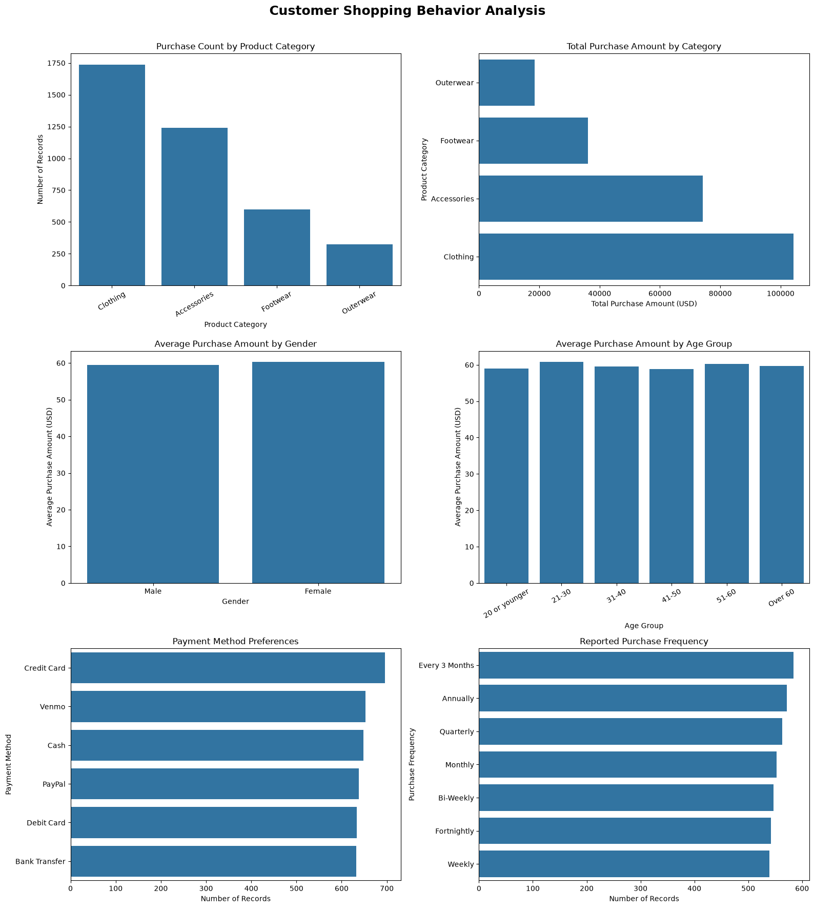

# Customer Shopping Behavior Analysis

## Project Overview

This project explores customer shopping patterns using Python, Pandas, NumPy, Matplotlib, and Seaborn. It examines product category demand, purchase amounts, customer demographics, payment preferences, and reported purchase frequency to identify patterns that may support retail business decisions.

## Objectives

- Identify the most popular product categories.
- Compare average and total recorded purchase amounts across categories.
- Analyze spending by gender and age group.
- Explore payment preferences and reported purchase frequency.
- Examine relationships between numerical variables.
- Generate business insights using data analysis and visualization.

## Tools and Technologies

- **Python** — programming language
- **Pandas** — data manipulation and analysis
- **NumPy** — numerical computing
- **Matplotlib** — visualization
- **Seaborn** — statistical visualization
- **Jupyter Notebook** — interactive analysis

## Dataset

The project uses the Customer Shopping Trends dataset, containing customer demographics, product categories, purchase amounts, payment methods, and shopping preferences.

**Source:** [Customer Shopping Trends Dataset on Kaggle](https://www.kaggle.com/datasets/iamsouravbanerjee/customer-shopping-trends-dataset)

## Project Workflow

1. Loaded and inspected the dataset.
2. Examined data types, missing values, and duplicate records.
3. Analyzed purchase counts and purchase amounts by product category.
4. Compared average spending by gender and age group.
5. Examined payment methods and reported purchase frequency.
6. Reviewed customer history fields and numerical correlations.
7. Created six visualizations using Matplotlib and Seaborn.
8. Generated a key business insights summary using Python.
9. Developed potential business recommendations based on the findings.

## Key Business Insights

- **Product Demand:** Clothing was the most popular product category by purchase count.
- **Category Spending:** Footwear had the highest average purchase amount.
- **Gender-Based Spending:** Female customers had a higher average purchase amount than male customers.
- **Payment Preferences:** Credit cards were the most common payment method.
- **Average Purchase Amount:** The average recorded purchase amount was $59.76.
- **Reported Purchase Frequency:** Every 3 Months was the most frequently reported purchase interval.

Additional category totals and record counts are calculated by the notebook from the dataset.

## Visualizations

The dashboard below highlights customer shopping patterns, product category performance, spending behavior, payment preferences, and purchase frequency.



## Business Recommendations

- Use category demand to inform inventory planning.
- Investigate footwear spending patterns and consider complementary-product promotions.
- Compare customer segments using purchase counts and average purchase amounts.
- Provide a convenient checkout experience for popular payment methods.
- Test promotions aligned with reported purchase intervals and measure their actual results.

These are recommendations to test, not proven outcomes of the analysis.

## Limitations

- Purchase amounts are recorded purchase values, not profit.
- Profit analysis requires product costs or profit-margin data.
- Reported purchase frequency does not independently verify actual repeat transactions over time.
- Customer purchase-history fields are not a substitute for longitudinal transaction records.
- Correlation does not establish causation.
- Findings describe this dataset and may not represent every retail customer.

## Project Structure

```text
Customer-Shopping-Behavior-Analysis/
├── data/
│   └── shopping_trends.csv
├── notebooks/
│   └── customer_shopping_analysis.ipynb
└── README.md
```

## Conclusion

This project demonstrates exploratory data analysis with Python. It identifies patterns in product demand, spending, customer demographics, payment preferences, and reported shopping frequency. The resulting insights provide a foundation for data-informed retail analysis and marketing decisions.
